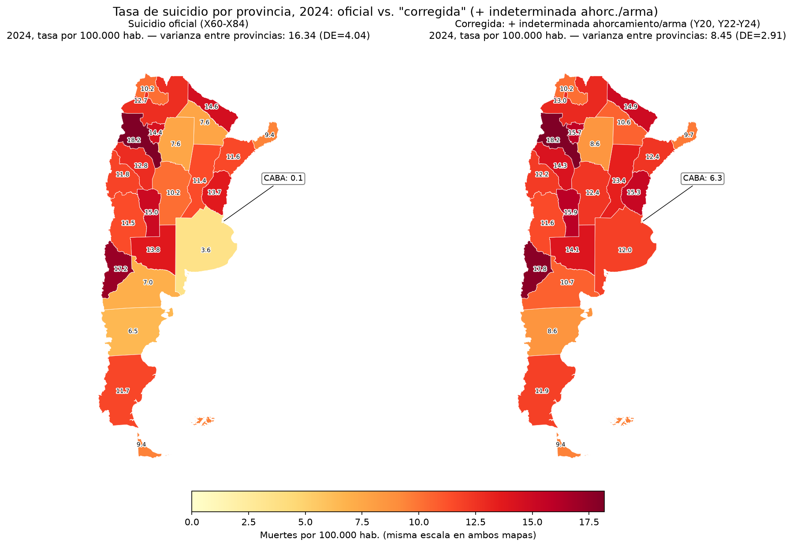
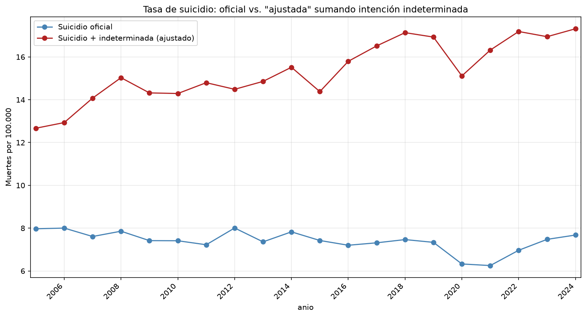
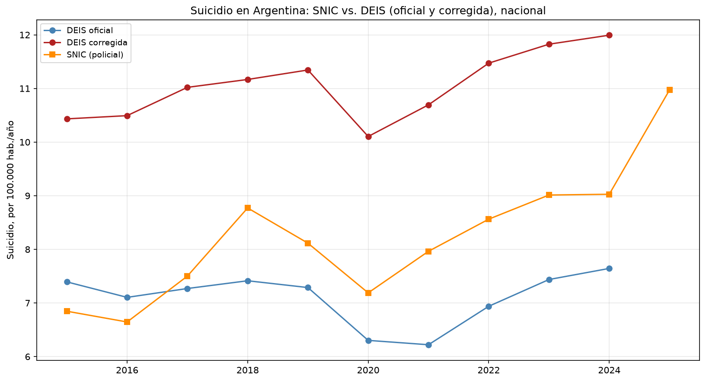
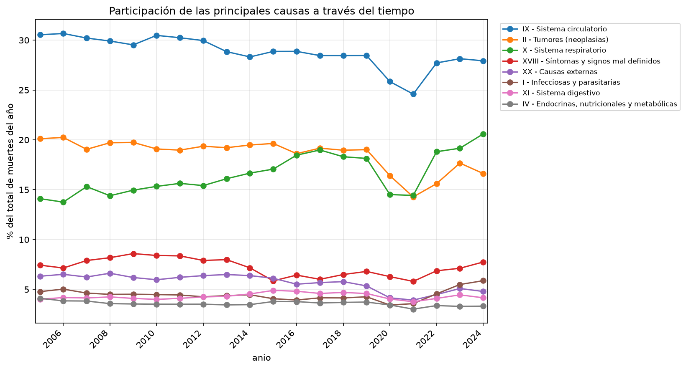
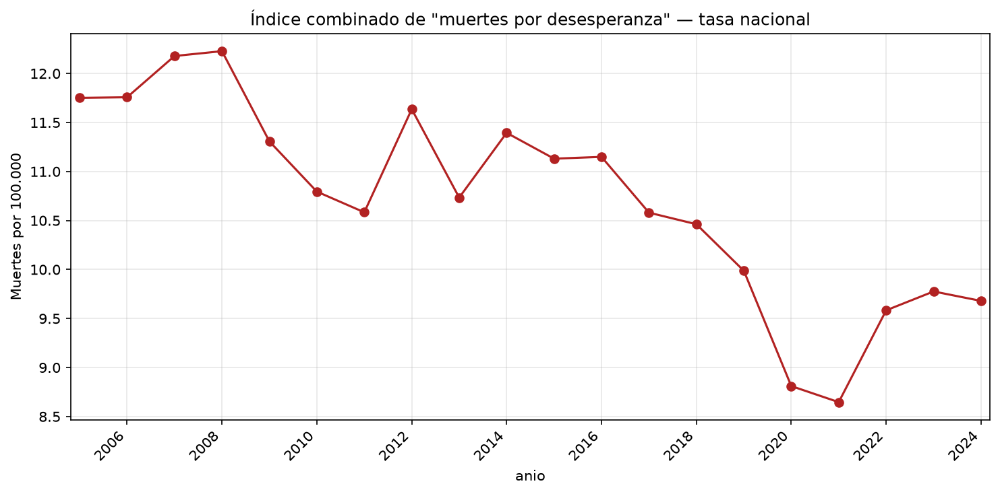

# Causes of Death in Argentina, 2005–2024

How do Argentines die, and how much of the suicide rate is hiding in the "undetermined intent" category?

This project analyzes the universe of registered deaths in Argentina (DEIS vital statistics, 2005–2024), and cross-checks suicide against an independent police-based source (SNIC, 2000–2025).



## Key findings

- **The official suicide rate probably understates the real one.** Deaths coded as *undetermined intent* (ICD-10 Y10–Y34) are as large as confirmed suicides (X60–X84), and they have grown faster. When I add only the undetermined deaths whose mechanism matches typical suicides (hanging Y20, firearm Y22–Y24), the 2024 national rate goes from **7.6 to 12.0 per 100,000**.
- **Much of the gap between provinces is a classification artifact.** After the correction, the variance of provincial suicide rates in 2024 falls by about half, from 16.3 to 8.5. Buenos Aires Province (3.6 → 12.0) and CABA (0.1 → 6.3) move the most. That points to differences in forensic and coding practice between jurisdictions, not in actual suicide levels.
- **The police data (SNIC) falls between the two DEIS series.** SNIC suicide rates sit between the official and corrected DEIS rates in most years. That supports reading the official DEIS figure as a lower bound. SNIC also has a reporting gap for Buenos Aires Province in 2009–2013 (≈3 victims/year vs. ≈1,000), which the notebook documents and works around.
- **"Deaths of despair."** Following Case & Deaton, the first notebook builds a suicide + overdose + alcohol index by sex, age and region. It also uses a firearm-suicide share (FS/S) as a proxy for gun availability by province.

| | |
|---|---|
|  |  |
|  |  |

## Notebooks

| Notebook | What it does |
|---|---|
| [`deis_causes_of_death.ipynb`](deis_causes_of_death.ipynb) | Leading causes by ICD-10 chapter, age and region. External-cause breakdown. Provincial population denominators (INDEC projections). Rates per 100k. Deaths of despair. The undetermined-intent analysis. 2024 provincial maps. |
| [`snic_vs_deis_suicide.ipynb`](snic_vs_deis_suicide.ipynb) | Suicide from the police source (SNIC) by province and department (~500 departments). Includes mojibake repair with `ftfy`, fuzzy matching of department names to population data, and small-N handling. Cross-validation against both DEIS series. |

The notebooks are written in Spanish.

## Data

Small auxiliary files are included in `data/`: INDEC population projections, the department population panel, and the INDEC department shapefile. The large raw files are **not** in the repo. Download them into `data/`:

| File | Source |
|---|---|
| `defunciones-ocurridas-y-registradas-en-la-republica-argentina-entre-los-anos-2005-2022.csv`, `defuncion2023.csv`, `defuncion2024.csv` | [DEIS – Ministerio de Salud (datos.salud.gob.ar)](https://datos.salud.gob.ar/dataset/defunciones-ocurridas-y-registradas-en-la-republica-argentina-en-el-ano) |
| `snic-provincias.csv`, `snic-departamentos-anual.csv` | [SNIC – Ministerio de Seguridad (bases de datos)](https://www.argentina.gob.ar/seguridad/estadisticascriminales/bases-de-datos) |

## Reproduce

```bash
pip install -r requirements.txt
jupyter lab   # run the notebooks from the repo root
```

Both notebooks run top to bottom and write their figures to `figures/`.

## Caveats

ICD-10 codes are only 3 characters, so alcohol-attributable deaths are a floor. Rates are crude, not age-standardized. The "corrected" suicide series is an informed upper-range estimate, not a case-by-case reclassification. See the methodological notes inside each notebook.

## License

The code is released under the [MIT License](LICENSE). The figures in `figures/` are released under [CC BY 4.0](https://creativecommons.org/licenses/by/4.0/). The source data keep the terms set by the Ministry of Health (DEIS), the Ministry of Security (SNIC) and INDEC.

## Citation

If you use this code or its figures, please cite the repository. GitHub's "Cite this repository" button uses `CITATION.cff`.
